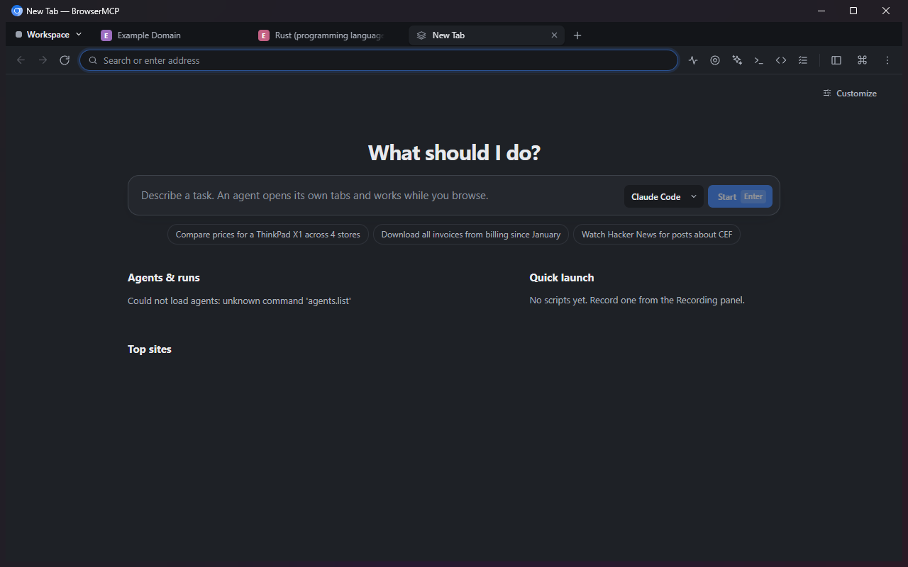
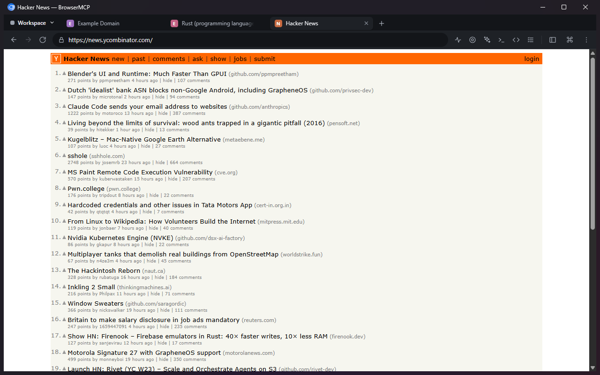
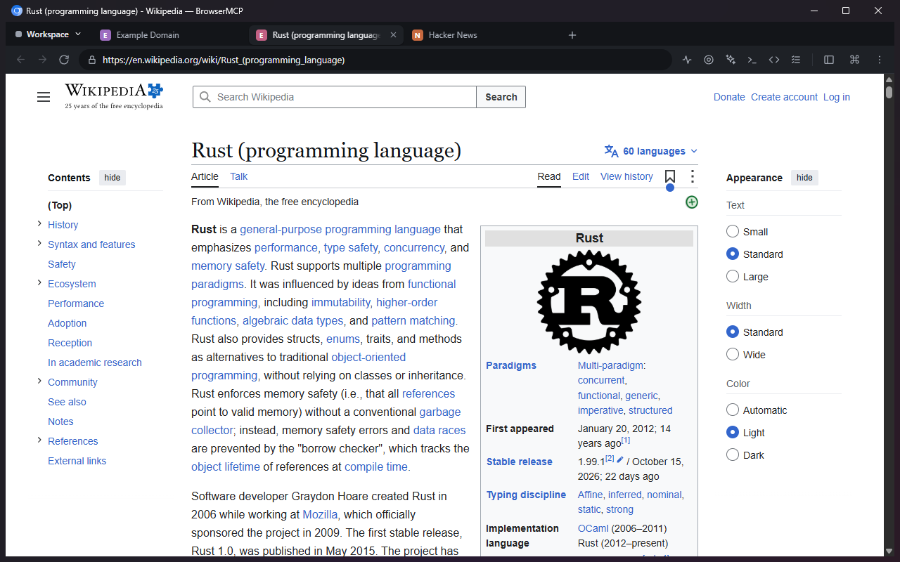
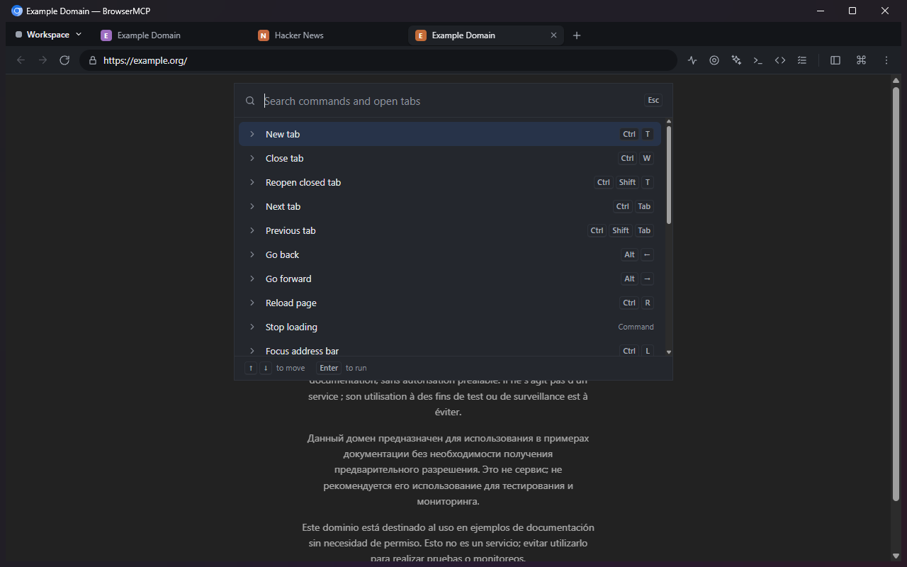
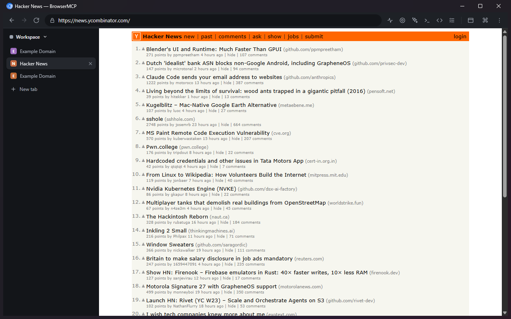
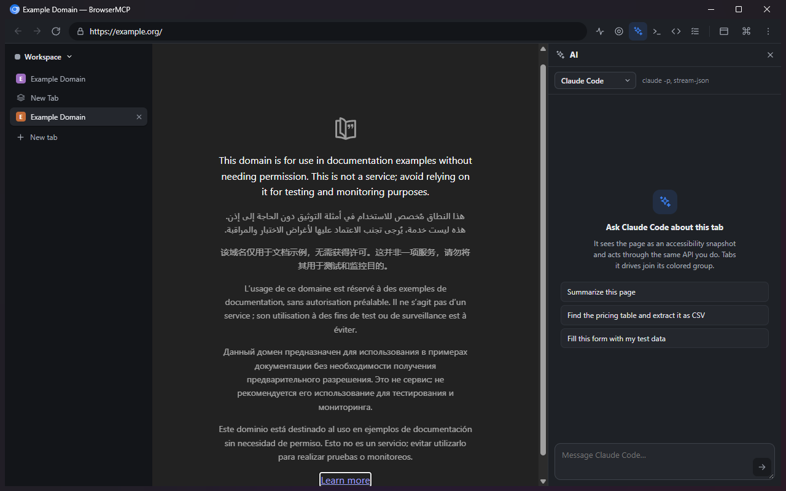
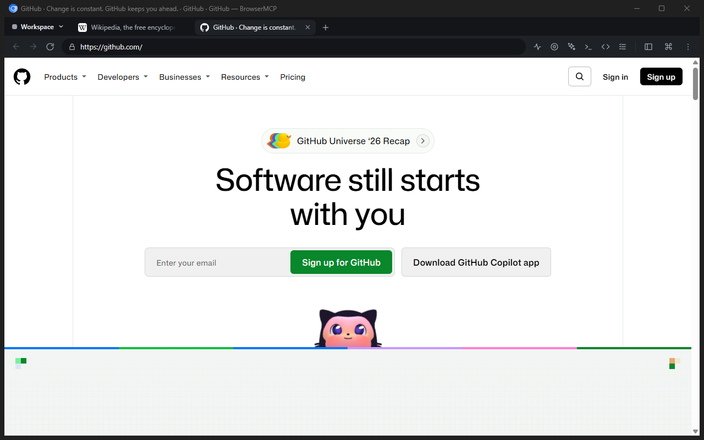

# Phase 2 (M2.1–M2.3): tabs + the real Svelte chrome

Date: 2026-11-06. CEF 156 Alloy, Windows 11. Builds on spike S1 (`docs/spikes/S1-S2-S3.md`).

## Window composition

```text
Window (no layout manager; chrome::place_views sets the bounds)
├─ UI view       bmcp://ui/index.html — fills the whole window, draws tab strip / toolbar /
│                vertical tabs / side panel, leaves a transparent page slot
├─ pages panel   placed over the page slot (window size minus the slot's insets)
│  └─ one content BrowserView per tab (FillLayout), only the active one visible
└─ overlay       bmcp://ui/palette.html — the Svelte palette (Ctrl+K)
```

The UI reports the slot with `bmcp://cmd/layout?x&y&w&h&vw&vh`; we keep it as insets from the
window edges, so a resize moves the page immediately. Because the slot just moves, **vertical
tabs and side panels work without extra views** (S1 used a fixed top strip).

## Tabs

* Per-window `TabStrip` (`bmcp_core::tabs`, unit-tested): order, active tab, right-then-left
  neighbour on close.
* New tab / `tabs.open {url?, background?}` → a content view with a pending intent (window,
  index, activate, reply channel) keyed by view id; `on_after_created` registers it, emits
  `tab.created`, answers `tabs.open`.
* Popups (`window.open`, `target=_blank`, middle click → background) become tabs right after
  their opener.
* Close: `close_browser(false)` → `DoClose`: one tab of several → we remove its view (browser is
  destroyed with it); the last tab → the window closes → exit code 0.
* `tab.created/updated/closed/activated` on the EventBus shared with the API.
  Favicons: `on_favicon_urlchange` (pitfall: cef-rs `CefStringList::clone()` iterates empty).

## Decisions

* **UI embedding:** `ui/dist` is embedded at compile time (`include_dir`, chosen by
  `crates/cef/build.rs`; placeholder pages if the UI was not built). `--ui-dir <path>` serves
  from disk, `--ui-dev <vite url>` (+ `BMCP_DEV_UI=1`) loads chrome and palette from Vite.
  The API URL is injected into every `bmcp://ui/` HTML page as `window.__BMCP__`.
* **Command channel:** data goes over WS (`tabs.*`, `nav.*`, events). `bmcp://cmd/` stays only
  for window-local plumbing that needs the sender's window: `layout`, `palette`,
  `focus-content`, `focus-omnibox`. The S1 `navigate/back/forward/reload/stop/ready` commands and
  the `bmcp.onState` push are gone; the S1 placeholder pages are gone.
* **Shortcuts:** `OnPreKeyEvent` in pages and the palette maps keys (mirror of the UI's
  `DEFAULT_KEYMAP`) to UI command ids and runs them in the chrome (`window.bmcp.run(id)`), i.e.
  the same code path as the UI's own keymap. Ctrl+K / Esc / Ctrl+L are native.
* **Permissions:** Alloy leaves permission prompts unanswered, and Chromium's Local Network
  Access asks before any page talks to 127.0.0.1 — every UI → API connection hung. A
  `PermissionHandler` now grants loopback/local-network access to `bmcp://ui` only and denies
  every other prompt (web pages get a fast failure instead of a hang).
* **Occlusion:** `--disable-features=CalculateNativeWinOcclusion` (merged into CEF's own list)
  and `--disable-backgrounding-occluded-windows`, so covered windows keep receiving input.

## Screenshots

| | |
|---|---|
|  |  |
| three tabs (one opened in background), new tab page, omnibox focused | `nav.goto` over REST: omnibox, title, back button follow |
|  |  |
| `tabs.activate` over REST | Svelte palette in the overlay view |
|  |  |
| vertical tabs: the page moves with the slot | vertical tabs + AI side panel |
|  | |
| favicons from `on_favicon_urlchange` | |

## Not done / known gaps

* ~~One `tabs.list` for all windows~~: tabs now carry `window`, the chrome filters by its
  `?window=` key (`docs/phase2/chrome-features.md`).
* ~~Menus/dropdowns hidden under the page~~: the page is hidden while one is open (same doc).
* Shortcuts from pages use the default keymap only (no `keymap.json` yet).
* Closing a window whose tabs cancel `beforeunload` leaves the window open with the other tabs
  detached one by one (not tested with a real prompt).
* Session restore is done (`docs/phase2/chrome-features.md`); tab groups (`groups` is always
  `[]`), drag-reorder (`tabs.move`) are later.
* `cef::shutdown()` still sometimes takes ~15–20 s (seen once in this phase, S1 pitfall).
