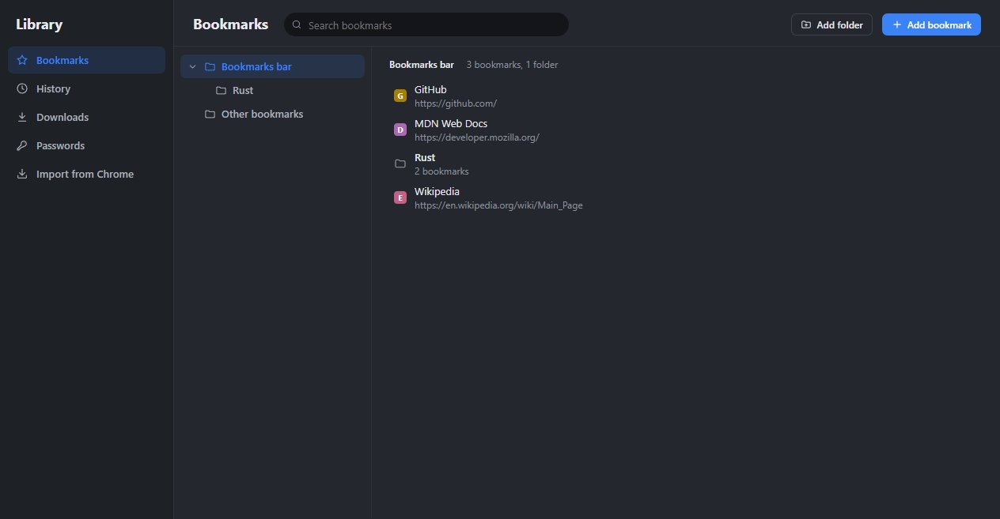
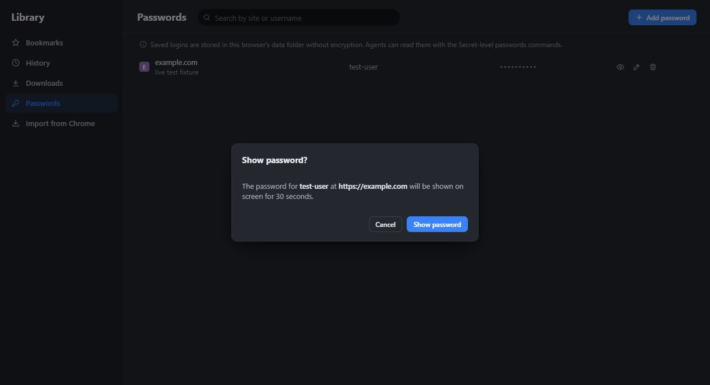
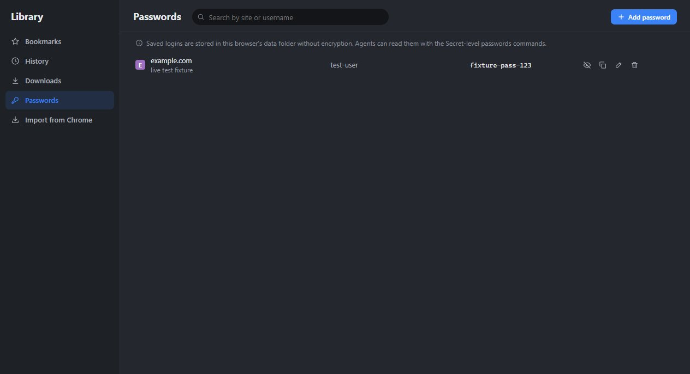
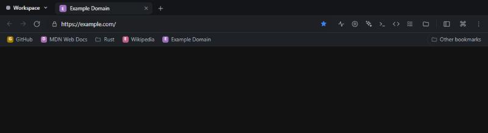
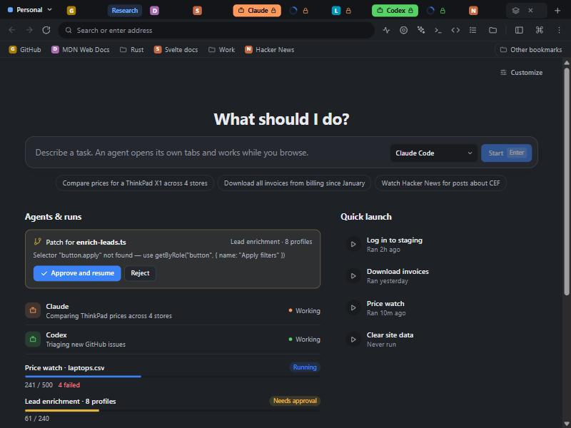

# Phase 4 UI: library, bookmarks bar, Chrome import

Date: 2026-11-06. The daily-driver data of `crates/data` (bookmarks, history, downloads,
passwords, Chrome import) gets its UI: a full-tab library page `bmcp://ui/library.html`, the
omnibox star and a bookmarks bar in the chrome, and a first-run import wizard. Code map and
behaviour: `ui/README.md` ("Library").

## What is there

* **Library page** (`ui/library.html`, `ui/src/library/`): Bookmarks (folder tree, drag to
  reorder / move into folders, add / edit / delete, search), History (search, grouped by day,
  remove a page or a day, clear a range), Downloads (list with progress; "Show in folder" is a
  stub), Passwords (search, reveal after a confirmation for 30 s, copy, add, edit, delete),
  Import from Chrome (the wizard).
* **Chrome**: star in the omnibox (Ctrl+D), bookmarks bar under the toolbar (Ctrl+Shift+B), a
  Library button in the toolbar, a Library section in the menu, palette commands, Ctrl+Shift+O /
  Ctrl+H / Ctrl+J open the library at Bookmarks / History / Downloads (the section travels via
  localStorage, the URL has no query).
* **First run**: with no `bmcp.import.offered` flag and an empty database (no bookmarks,
  folders or history) the chrome opens the library at the import wizard once.
* **Native**: `crates/cef/src/scheme.rs` `is_allowed_in_content` also lets content tabs load
  exactly `bmcp://ui/library.html` (one line; no query or fragment accepted for it).
* **Contract fix** in `crates/app/src/main.rs`: `start_api` called `bmcp_api::serve(.., port, ..)`
  while still holding the listener bound before CEF, so the API never started ("Only one usage
  of each socket address"); it now calls `serve_on(.., listener, ..)` (one line).

## Verified

* `pnpm -C ui check` (0 errors, 0 warnings), `pnpm -C ui test` (new: `data/tree.test.ts`,
  `history.test.ts`, `wizard.test.ts`, `library.test.ts` — tree building, drop positions, day
  grouping across month ends, clear plans, the wizard state machine, first-run decision, composed
  edits against the stateful mock), `pnpm -C ui build` (4 entries).
* Mock (`pnpm dev`): every section, bookmarks bar folder click opening the library tab at that
  folder, Ctrl+H switching the open library to History, password reveal after the dialog, the
  wizard with a quoted pasted CSV path and per-part results.
* Real browser (`browsermcp --api-port 47862 --data-dir target/live-data --ui-dir ui/dist`),
  bookmarks / a folder / a login added over REST, history from `nav.goto`:
  * `tabs.open bmcp://ui/library.html` loads the library in a content tab (allow-list line);
    `bmcp://ui/library.html?api=ws&ws=ws://evil/` is refused (tab stays empty).
  * Library on the real core: bookmark tree with the REST folder, History grouped under Today,
    Passwords: eye → confirmation dialog → `passwords.list {origin, reveal:true}` shows the
    fixture password (driven with `page.act`, screenshots with `page.screenshot`).
  * Dev chrome against the real core (WS via a local Origin-stripping proxy, since only Vite on
    5173 is allowed and another agent held that port): the bar lists folder 1, the star on
    example.com called `bookmarks.add` (checked with `bookmarks.search`), the bar showed it, and
    Ctrl+H opened `bmcp://ui/library.html` as a real tab.
  * Not run: `import.chrome` against real Chrome data (by design; the wizard was exercised with
    the mock only). The first-run wizard did not open live because the start page
    (example.com) was already in history when the chrome checked — correct for that state.
  * Both browser instances shut down on their own after a while (`CEF shut down` in the log, no
    crash); the cause was not investigated.

## Screenshots

| | |
|---|---|
|  |  |
| real core: bookmark tree, folder from REST | real core: history grouped by day |
|  |  |
| real core: reveal needs a confirmation | revealed fixture login (hidden again after 30 s) |
|  |  |
| dev chrome on the real core: star on, page in the bar | mock: bookmarks bar under the toolbar |
|  |  |
| mock: library opened from a bar folder | mock: import wizard, two Chrome profiles |
|  |  |
| mock: per-part import results | mock: reveal dialog |

## Gaps

* The core has no `bookmarks.update` / rename: editing a bookmark or renaming a folder is
  add + move + remove (`ui/src/lib/data/edit.ts`), so the node gets a new id; renaming a folder
  moves its children one call at a time.
* `history.delete` can only forget everything *before* a time or one URL. "Last hour / 24 h /
  7 days / 4 weeks" therefore remove each page visited in the range **with all its visits**
  (older ones too); "Remove day" does the same for that day's pages. A `history.delete {since}`
  (visits after a time) would make it exact.
* No data events: the bar and the star re-read after their own edits, on a localStorage tick
  from the library page, on reconnect and on window focus. Bookmarks added by an agent over REST
  show up on the next of those.
* ~~Shortcuts while a web page has focus~~: Ctrl+D, Ctrl+H, Ctrl+J, Ctrl+Shift+O, Ctrl+Shift+B
  are in the native keymap mirror now (`crates/cef/src/chrome/protocol.rs`).
* ~~The menu's Library section is covered by the page~~: the page is hidden while a chrome
  dropdown is open (`docs/phase2/chrome-features.md`).
* Bookmarks-bar folders open the library at that folder instead of a dropdown (same reason).
  No drag and drop on the bar itself.
* Downloads: `downloads.list` is filled by a later CEF hook, so the live list is empty; "Show in
  folder" only shows the path.
* With `--ui-dev` the chrome comes from Vite (another origin) and does not share localStorage
  with `bmcp://ui/library.html`, so the section request does not reach the page there.
