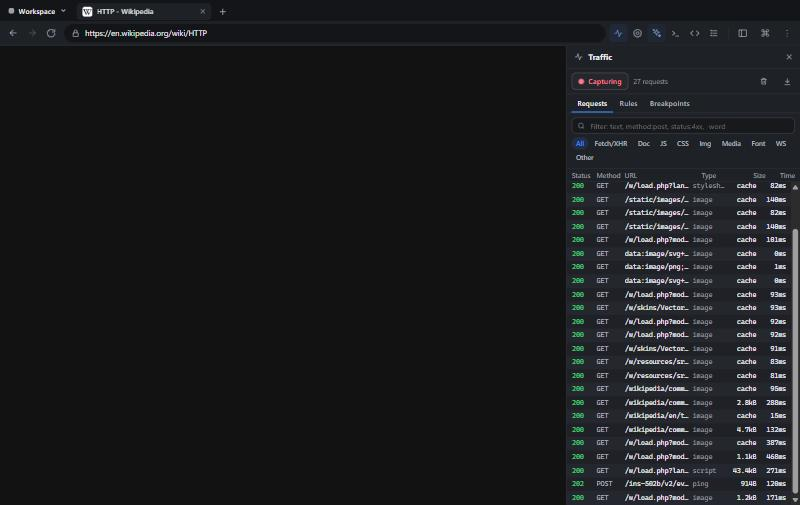
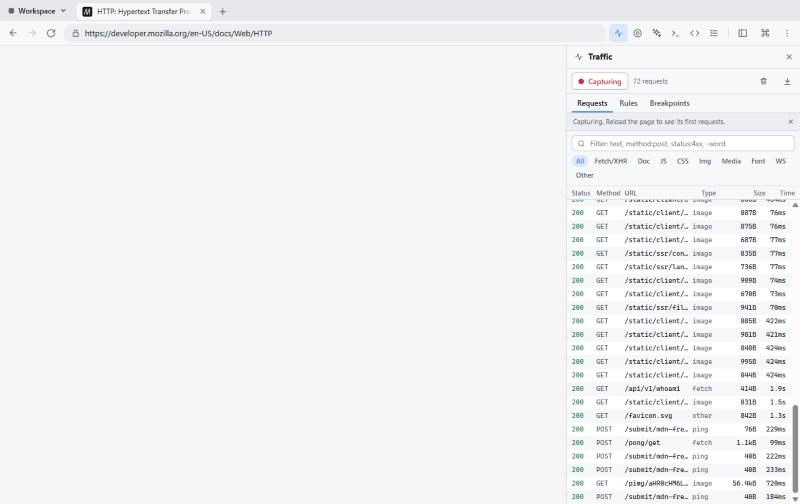
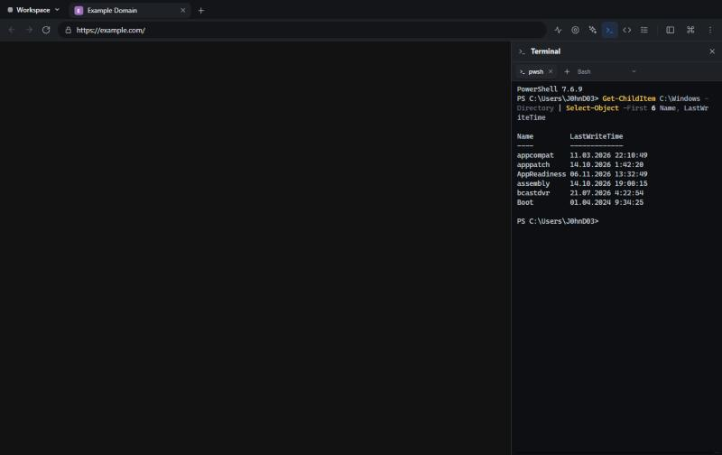
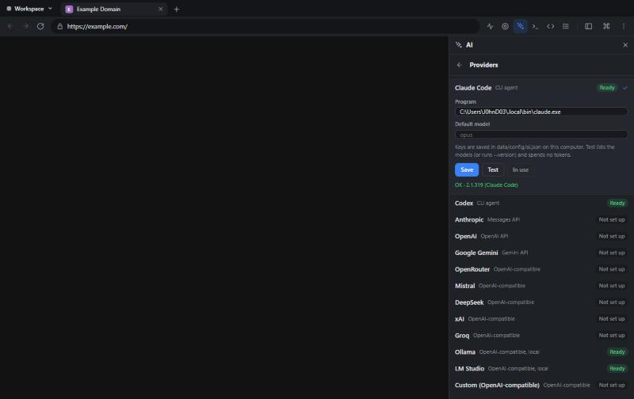
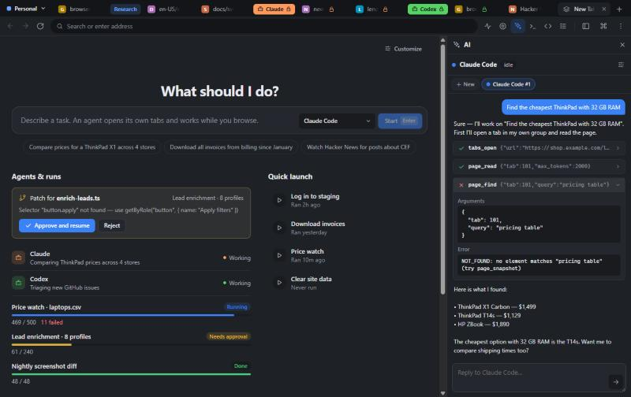
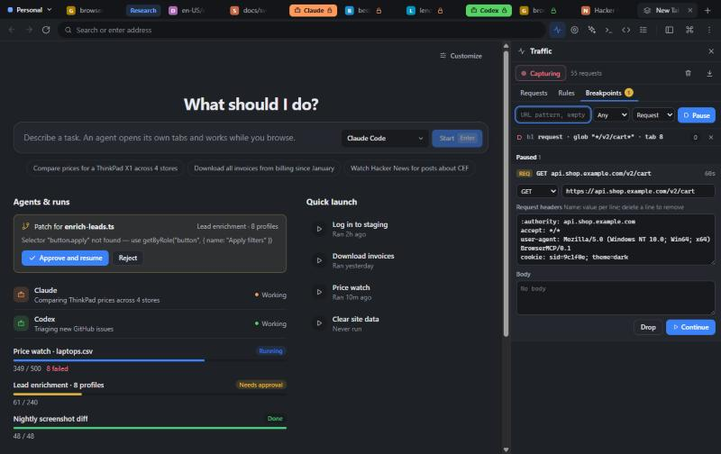
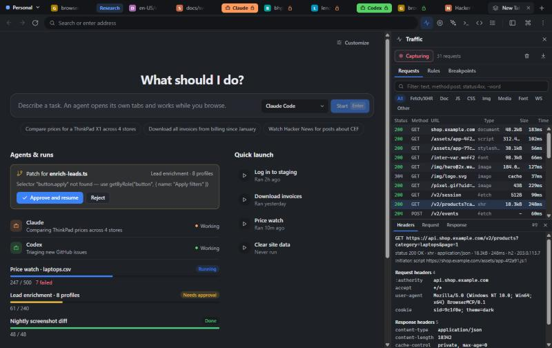
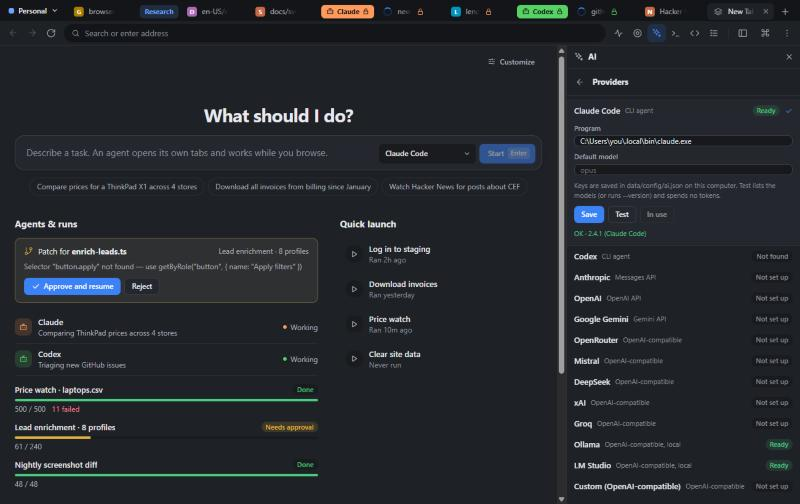

# Phase 5/6 UI: AI, Terminal and Traffic side panels

Date: 2026-11-06. The three side panels of the Svelte chrome now run on the real core
(`crates/ai`, `crates/net`) over the JSON-RPC WebSocket. Code map and behaviour: `ui/README.md`
("Side panels").

## Verified

* `pnpm -C ui check` (0 errors, 0 warnings), `pnpm -C ui test` (74 tests: AI stream folding,
  net text parsers, request filter, rule and resume payloads), `pnpm -C ui build`.
* Mock (`pnpm dev`, no backend): every panel, incl. a scripted streaming chat with tool calls,
  a toy shell and generated traffic with rules and breakpoints.
* Real browser (`browsermcp --api-port 47830 --data-dir target/live-data --ui-dir …`), driven
  over REST plus the dev UI (`?api=ws&ws=ws://127.0.0.1:47830/v1/ws`, `BMCP_DEV_UI=1`):
  * Traffic: `net.capture` on, Wikipedia/MDN loads appear in the list (status, type, size, time);
    details show headers and a response body (`net.get` parts); a block rule added and removed
    from the Rules tab; a breakpoint on the document paused the reload, the `net.paused` event
    filled the editor with the real request headers, Continue resumed it (`continued p3 …`);
    a pause left alone showed the core's `net.pause_timeout` warning; HAR export wrote
    `data/har/tab3-….har` (95 requests).
  * Terminal: the chrome's panel opened pwsh by itself and sized the PTY (47×35); a command sent
    with REST `term.write` rendered in xterm.js; cmd and Git Bash tabs opened and closed; no
    cursor-report garbage at start.
  * AI: `ai.providers` lists all 13 presets with their state; `ai.provider_test` on Claude Code
    (`2.1.319`) and Codex (`codex-cli 0.166.0-alpha.5.1`). No session was started against the
    real core (paid calls); the chat was exercised with the mock only.

## Screenshots

| | |
|---|---|
|  |  |
| real core: captured Wikipedia traffic | light theme, MDN |
|  |  |
| real pwsh, command sent with REST `term.write` | providers from `ai.providers`, Claude Code tested |
|  |  |
| mock: streamed answer, tool rows (one failed, expanded) | mock: paused request in the editor |
|  |  |
| mock: request details | mock: provider settings |

The live shots are of the dev UI against the real core: screenshots of the CEF window itself were
skipped because that window was never the foreground window when checked.

## Gaps

* `net.list` / `net.get` / `net.rule_list` / `net.paused_list` return text made for agents, so the
  UI parses it (`ui/src/lib/net/parse.ts`). URLs over 120 characters arrive shortened in the
  middle; the details pane shows the full one. A structured output next to `text` would be
  sturdier.
* There is no command to read a tab's capture state; the panel learns it from the `net.list`
  header (`(capture off)`) or a NOT_FOUND error.
* `ai.*` streaming was not seen live (it needs a paid session); the reducer follows the event
  contract in `crates/ai/src/session.rs` and is unit-tested.
* Ollama / LM Studio report `configured: true` whether or not the local server runs; use Test.
* HAR export writes to `data/har/` (path shown); the UI does not offer a save dialog.
