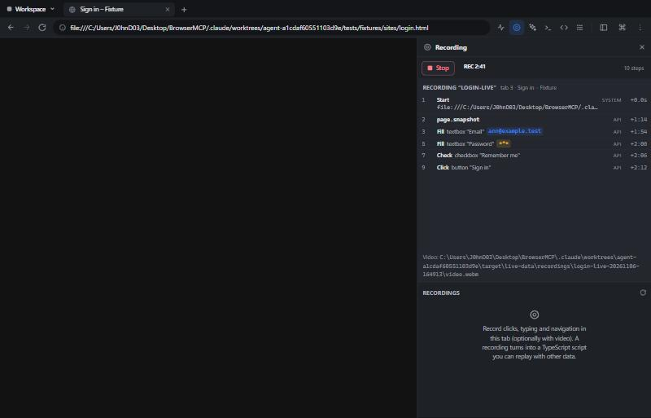
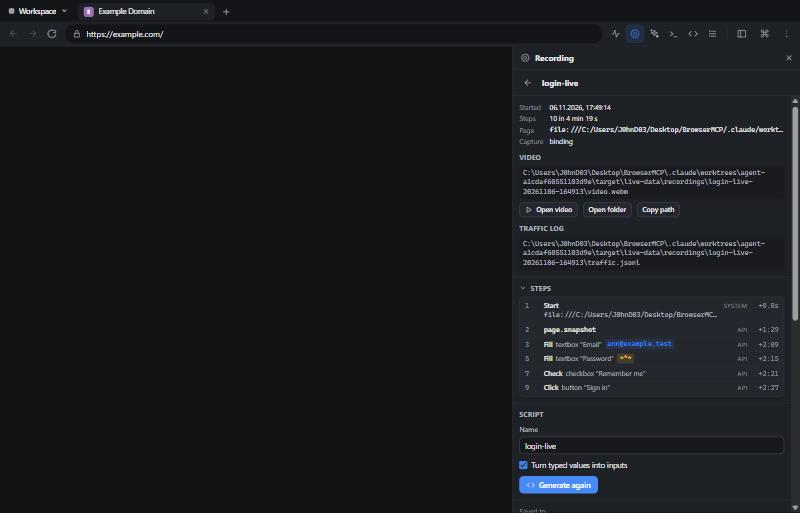
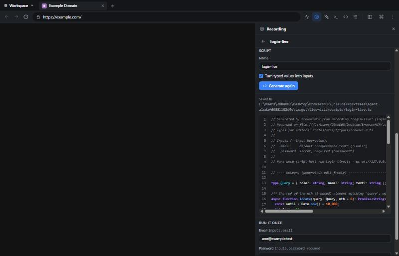
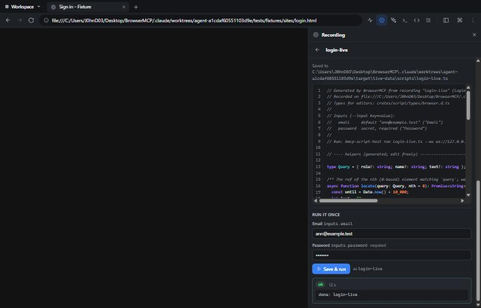
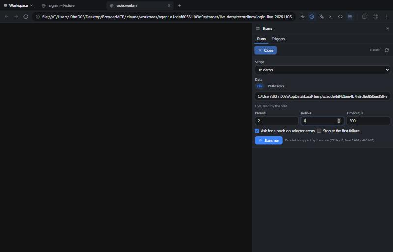
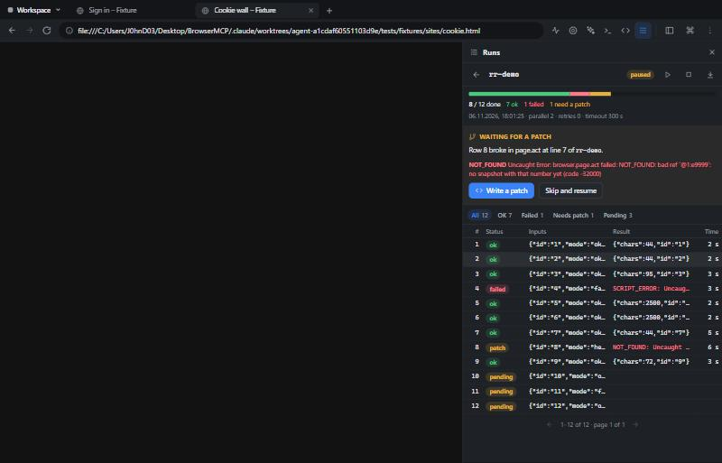
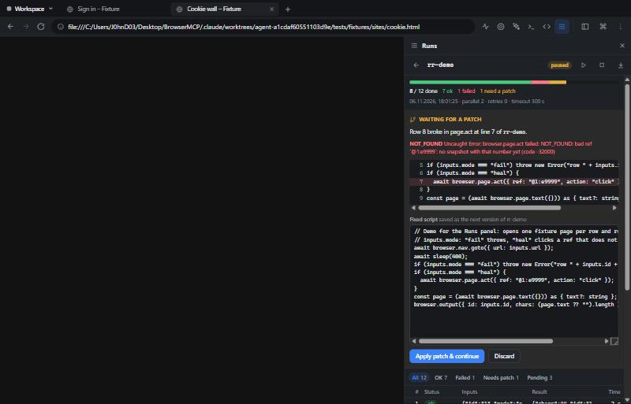
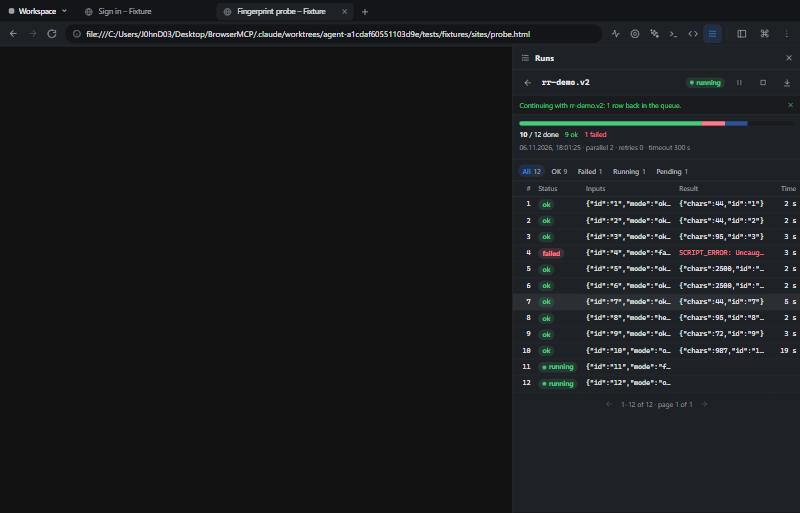
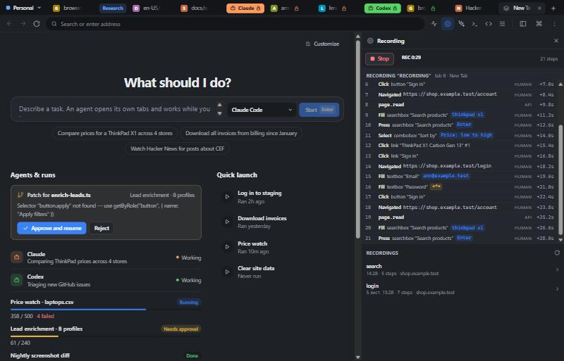
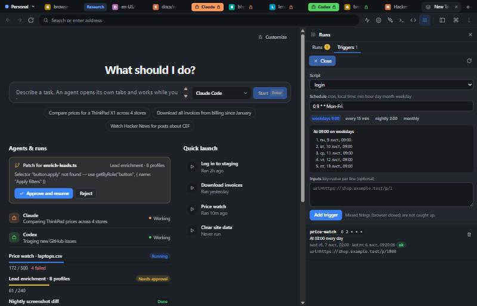

# Phase 7 UI: Recording and Runs side panels

Date: 2026-11-06. The Recording and Runs panels of the Svelte chrome run on the real core
(`crates/record`, `crates/jobs`) over the JSON-RPC WebSocket. Code map: `ui/README.md`
("Side panels").

## What is there

* **Recording**: record / stop the active tab (options: video, network traffic), live step list
  from `record.step` (API and human steps, human copies of API actions hidden, secrets as `***`),
  saved recordings (`record.list`), a recording's facts, video / traffic paths (*Open video* and
  *Open folder* open a `file://` tab through the core, *Copy path*), its steps, *Generate script*
  (`record.codegen`, optional parametrize) in a read-only view highlighted with Prism (lazy chunk,
  7.7 kB gzip), an inputs form inferred from `inputs.<name>`, `inputs["name"]` and codegen's
  `need("name")` (defaults prefilled, secrets as password fields, required ones checked) and
  *Save & run* (`script.save` + `script.run`, result / error / stdout shown).
* **Runs**: new run form (script picker from `script.list`; data as a file path, csv / json /
  xlsx by extension, or pasted rows: JSON array, JSON lines or CSV/TSV with header; parallel,
  retries, timeout, heal, stop on error), run list with segmented progress bars kept current by
  `run.progress` / `run.finished`, run detail with pause / resume / cancel, export (csv, xlsx,
  json, sqlite, webhook; all or only ok / failed rows), status filter chips with counts, a paged
  results table (`run.results` cursors, 50 per page, back without refetching cursors) with
  expandable rows (error code / command / line, inputs, result, output), and the heal flow:
  `run.heal_needed` shows the failing row, step, line and error, *Write a patch* loads the script
  (`script.get`) with the failing line in context, *Apply patch & continue* calls `run.heal_apply`,
  *Skip and resume* calls `run.resume`.
* **Triggers** (sub-tab of Runs): list with spec, a readable description, next and last firing,
  last status and inputs; remove; add with a live preview of the next five firings computed in
  the UI. The preview follows the Rust `cron` crate the core uses: weekday numbers are 1 = Sunday
  … 7 = Saturday (Unix uses 0-6), so `0 9 * * 1-5` means Sunday–Thursday and the form says so;
  day of month and weekday must both match.

Types come from the generated protocol (`sdk/protocol/src/generated/commands.ts`):
`ui/src/lib/api/types-record-runs.ts` adds the 24 commands and 9 events to `RpcMethods` /
`ApiEvents` by declaration merging; the event payloads are written out from the Rust `json!`
calls. Fakes: `ui/src/lib/api/mock-record-runs.ts` (live recording, codegen, runs that progress,
a heal request, triggers). Shared-file edits are one line each in `types.ts`, `mock.ts`
(import + spread), `ws.ts` (topics `record.*`, `run.*`, `trigger.*`) and the panel switch in
`SidePanel.svelte`.

## Verified

* `pnpm -C ui check` (0 errors, 0 warnings), `pnpm -C ui test` (108 tests; new: cron parsing /
  next firings / descriptions / warnings, results pager, data sources and pasted rows, progress
  folding, step upsert / jsonl / descriptions, inputs inference, script names, file URLs),
  `pnpm -C ui build`.
* Mock (`pnpm dev`): every view, incl. a live recording, codegen, Save & run, a run that pauses
  for a patch, triggers.
* Real browser (`browsermcp --api-port … --data-dir target/live-data`, `BMCP_DEV_UI=1`, dev UI
  `?api=ws&ws=ws://127.0.0.1:<port>/v1/ws`), state driven over REST:
  * `record.start` (video + traffic) on a fixture login page, then `page.act` fill / fill
    (password) / check / click over REST: the panel listed each step live from `record.step`,
    the password as `***`; *Stop* in the panel (`record.stop`) wrote actions.jsonl, meta.json and
    video.webm (367 kB).
  * *Generate script* (`record.codegen`, parametrize): code shown highlighted, inputs `email`
    (default) and `password` (required, secret) inferred; *Save & run* refused without the
    password, then ran the script on the core (`ok`, 12 s, `done: login-live`).
  * *Open video* opened the recording's video.webm in a new browser tab.
  * New run from the form: `rr-demo` over a 12-row CSV, parallel 2, retries 0: progress bar and
    results table updated live; row 8 broke on `page.act` with `NOT_FOUND`, `run.heal_needed`
    paused the run and the heal box showed row, step, line and the source around line 7; the
    patch applied from the editor became `rr-demo.v2`, 1 row went back to the queue and the run
    finished (10 ok, 2 failed on purpose). The *Failed* filter showed the 2 failed rows.
  * Over REST on the same data: `trigger.set` `0 9 * * Mon-Fri` → core `next_fire`
    2026-11-09T09:00 (Monday), the same as the UI preview; `run.export` csv (12 rows) and xlsx
    with `status: failed` (2 rows) wrote `data/runs/<id>/results.*`.

## Screenshots

| | |
|---|---|
|  |  |
| real core: steps arrive live (`record.step`) | saved recording with video and traffic paths |
|  |  |
| `record.codegen` output, inferred inputs | *Save & run* result |
|  |  |
| new run form | `run.heal_needed` on row 8, live results |
|  |  |
| patch editor, failing line in context | `run.heal_apply` → `rr-demo.v2`, run continues |
|  |  |
| mock: live recording | mock: trigger form with next firings |

## Contract fix (Rust)

`crates/app/src/main.rs`: `start_api` received the listener bound before CEF starts but called
`bmcp_api::serve(…, port, …)`, which binds the port a second time, so on Windows the API never
started ("Only one usage of each socket address"). It now calls `bmcp_api::serve_on(…, listener,
…)`. One line.

## Gaps

* Not exercised live: pause / resume / cancel and export from the panel's buttons (the commands
  and the exact arguments the panel sends were checked over REST and in the mock), the trigger
  form against the core (only `trigger.set` over REST) and `trigger.fired`. During the session
  the test browser kept closing itself gracefully after 1-6 minutes even when idle and on a
  second port (something outside this work closed its window), which cut the live session short.
* The recording panel records the active tab; there is no tab picker.
* *Open folder* opens a `file://` directory listing in a tab, not Explorer: there is no core
  command to reveal a file in the OS shell.
* Webhook export is offered but was not tested against a receiver; `google_sheets` (not
  implemented in the core) is not offered.
* The results table reloads the current page at most once a second while a run is active; with
  thousands of rows per page it would want virtualization.
