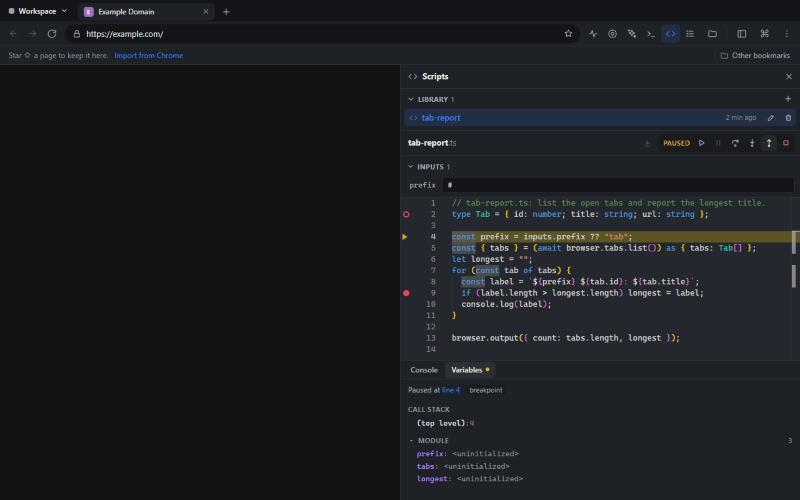
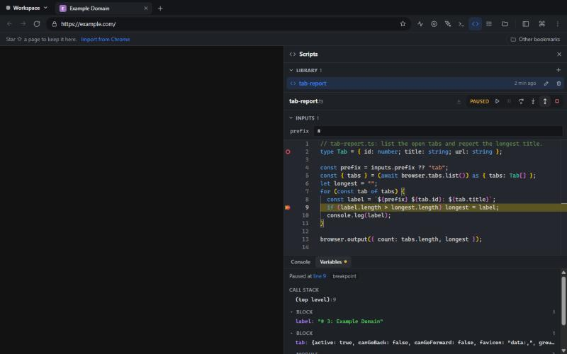
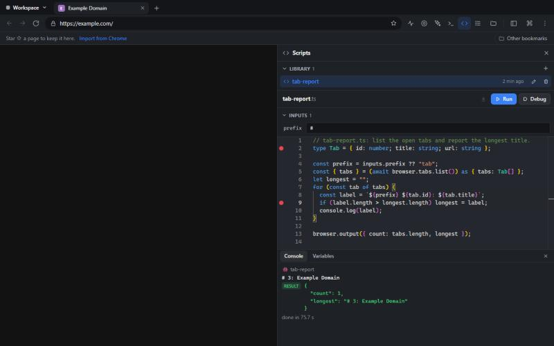
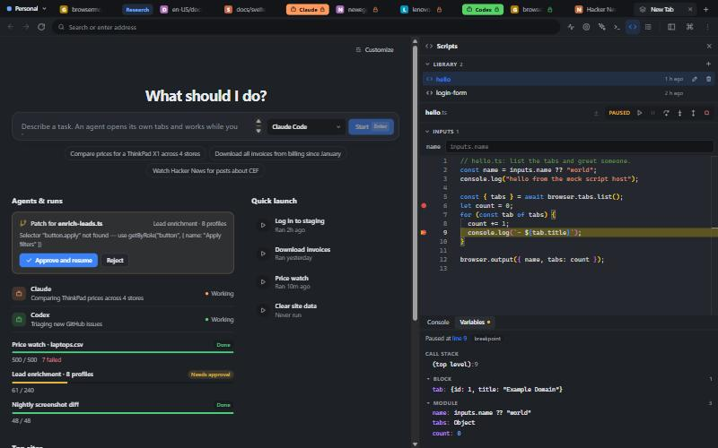
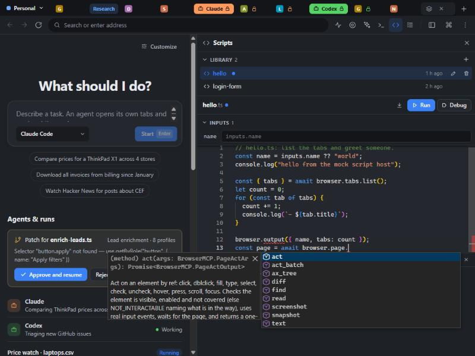

# Phase 8 M8.2–M8.3: Scripts panel and step debugger

Date: 2026-11-06. The Scripts side panel edits, runs and step-debugs the TypeScript scripts of
`data/scripts/` against the real core. Code map: `ui/README.md` ("Side panels → Scripts"),
`crates/script/src/debugger.rs` (host side), `crates/jobs/src/debug.rs` (command side).

## How debugging works

```text
UI (Monaco)  ── script.debug_start {name|code, inputs, breakpoints:[ts lines]} ──>  core (crates/jobs/src/debug.rs)
                                                                                     │ spawns
                                                                                     ▼
                                   bmcp-script-host run <file> --ws … --inspect pipe   (crates/script)
                                     V8 thread: load module → wait → evaluate
                                     controller thread: CDP (Debugger.*, Runtime.getProperties)
                                       stdin  <── {"id":n,"method":"step_over"}            (script.debug_cmd)
                                       stdout ──> ##bmcp:debug {"method":"paused",…}        -> script.debug_paused
                                       stdout ──> ##bmcp:debug {"method":"resumed"}         -> script.debug_resumed
                                       stdout ──> console lines / ##bmcp:result {…}         -> script.debug_output
                                       exit                                                -> script.debug_ended
```

* `--inspect` is off by default; without it the host runs exactly as before (no inspector).
  `--inspect pipe` = commands on stdin, events on stdout; `--inspect <port>` = the same protocol
  as newline-delimited JSON on one TCP connection at 127.0.0.1:port (printed to stderr).
* The module is loaded (transpiled, compiled) before the debugger attaches, so breakpoints are
  set on real code: a TS line is mapped to the first generated JS position through the
  transpiler's source map (a type-only or empty line moves to the next line with code), and the
  location V8 reports back is mapped to a TS line again. Pauses, call frames and the
  `set_breakpoints` answer are all in 1-based TS lines.
* `scopes` = the top frame's scopes without `global` (local, block, closure, module…), one level
  of variables, every value a short string (`{id: 1, url: "…"}`, `Array(3) [1, 2, 3]`, 120 chars
  max). `ext:` scripts (deno_core, the prelude) are blackboxed, so steps never stop inside them.
* A client that disconnects lets the script run to its end. The core kills a session on
  `script.debug_cmd {action:"stop"}`, after `timeout_secs` (default 30 min) or on shutdown.

### Commands

| Command | Args | Result |
|---|---|---|
| `script.debug_start` | `name` or `code`, `inputs?`, `breakpoints?: [line]`, `timeout_secs?` | `{id, breakpoints: [resolved lines], error?}` |
| `script.debug_cmd` | `id`, `action: continue \| step_over \| step_into \| step_out \| pause \| set_breakpoints \| stop`, `lines?` | `{breakpoints?}` |

Events: `script.debug_paused {id, reason, line, column, url, hit_breakpoints, call_frames:[{function,
line, url}], scopes:[{type, variables:[{name, type, value}]}]}`, `script.debug_resumed {id}`,
`script.debug_output {id, stream: stdout|stderr|result, text}`, `script.debug_ended {id, ok,
exit_code, duration_ms, result, stopped, error?}`.

## Verified

* `cargo test -p bmcp-script`: the debugger protocol without a browser (MockSink): breakpoint on
  a type-only line moves to the next line, pause on breakpoints, step into `add()` and read the
  argument, step over and read a local, step out, change breakpoints while paused, run past an
  `await`, read module variables; break on the first statement; a vanished client; a failing
  script ends as `failed`; the real binary with `--inspect pipe`.
* `cargo test -p bmcp-jobs --test debug`: the proxy (fake host speaking the same protocol):
  start → paused event → set_breakpoints → continue → output/result → ended; inline code errors
  with the parsed line and inputs passed through `--inputs-file`; stop; argument errors. With
  `BMCP_REAL_SCRIPT_HOST=<target>/debug/bmcp-script-host.exe` the same file also drives the REAL
  V8 host through the commands (an idle test WebSocket stands in for the browser): breakpoint on
  a type-only line lands on the next line, pause, `{n: 2}` loop variable, set_breakpoints while
  paused, output, result and end.
* `pnpm -C ui check / test / build`: inputs inference, console entries, key ownership, the mock
  debugger. Monaco is a lazy chunk: the chrome bundle stays ~0.44 MB; Monaco (~4 MB) and the
  TypeScript worker (~7 MB) load on first open of the panel. A Vite plugin drops Monaco's other
  languages (CSS/HTML/JSON workers, ~80 tokenizers): ui/dist went from 108 to 19 asset files.
* Dev UI (mock): gutter breakpoints, Debug, pause at a breakpoint with the current line, F10 in
  the editor steps without reloading the page (the chrome lets `data-own-keys` keys through),
  F5 continues, variables / call stack, Shift+F5 stops; Ctrl+Space on `browser.page.` lists the
  commands with their docs from browser.d.ts.

* Live: `browsermcp --api-port 47861 --data-dir target/live-data` (BMCP_DEV_UI=1,
  BMCP_SCRIPT_HOST = the worktree's host) with the dev UI (`?api=ws&ws=ws://127.0.0.1:47861/v1/ws`)
  in a browser preview. `tab-report.ts` (saved with REST `script.save`, `script.run` →
  `{count: 1, longest: "# 3: Example Domain"}`): breakpoints on line 2 (type-only) and 9,
  Debug → paused on line 4 (the moved breakpoint; the UI now redraws it there) with
  `prefix/tabs/longest` uninitialized; F5 → paused on line 9 AFTER the real
  `await browser.tabs.list()`, `label = "# 3: Example Domain"`, `tab = {active: true, …}` from
  the browser; F10; F5 → console line, RESULT `{count, longest}`, "done". The first start took
  ~10 s (V8 host cold start on a loaded machine).

## Screenshots

| | |
|---|---|
|  |  |
| real core: the line-2 breakpoint landed on line 4 | real core: paused after `browser.tabs.list()`, real tab object |
|  |  |
| real core: output + structured result after F5 | mock: paused, block + module variables |
|  | |
| IntelliSense from the generated browser.d.ts | |

## Gaps

* Breakpoints and line mapping only for the main script; a step into an imported module shows
  that module's JS line numbers.
* Variables are one level deep (no expanding objects), no watch expressions, no "pause on
  exceptions", no conditional breakpoints.
* `--timeout-secs` is not applied by the core to debug sessions (a paused script would be
  killed); the session lifetime (`timeout_secs`, default 30 min) is the limit instead.
* While paused, a pending browser command keeps its own timeout in the core.
* The panel does not ask before switching scripts: unsaved edits are kept per script in memory
  only (lost when the chrome reloads).
* Pre-existing, not from this change: `cargo test -p bmcp-script -p bmcp-jobs` in ONE command
  fails three bmcp-jobs unit tests (deno_core turns on serde_json `preserve_order` through feature
  unification, so JSON objects keep insertion order); each crate alone passes, and
  `cargo xtask test` excludes bmcp-script.
