# Settings page, heal UI, plugin palette entries

Date: 2026-11-06. The remaining integration UI of the core crates: a full-tab settings page
`bmcp://ui/settings.html`, the AI heal flow in the Runs panel, heal proposals as notification
questions (UI + Telegram), and plugin entries in the Ctrl+K palette. Code map: `ui/README.md`
("Settings page", "Side panels").

## What is there

* **Settings page** (`ui/settings.html`, `ui/src/settings/`, logic in `ui/src/lib/settings/`).
  Opened with Ctrl+, (`settings.open` in `keymap.ts`), the palette ("Settings") or *All
  settings…* in the menu; an existing settings tab is reused, a section request travels through
  localStorage like the library's. Sections:
  * **General**: theme, accent, density (new: compact chrome), vertical tabs, bookmarks bar, new
    tab widgets.
  * **AI**: the AI panel's provider settings component (`AiSettings.svelte`, now usable with its
    own `AiStore` and without the back bar) + *Make default for background AI*
    (`ai.provider_set {default: true}`, `is_default` badge) and an "in use" summary.
  * **Notifications**: channels UI / Windows / Telegram (bot token + chat id, masked token kept
    unless replaced) / webhook, each with *Test* (*Save & test* when there are unsaved changes);
    the rules table (order, channels, when, bundle, move / delete, unreachable rules flagged,
    "which rule handles <topic>", *Add N missing default rules* for configs written before the
    heal rules existed); anti-spam limits. Only changed fields are sent (`notify.config_set`).
  * **Performance**: governor on/off, profile (fills in its times), freeze / discard after N
    minutes, most live tabs, reset to profile defaults; live memory numbers and the tab table
    (state, idle, JS heap, why a tab is left alone) every 3 s, recent decisions.
  * **Privacy & blocking**: ad blocking on/off, update lists (per list result, force), counters
    (blocked / by filter / by policy, top hosts, by type, reset), sites where ads are allowed,
    site policies as a table (click cycles inherited → blocked → allowed; back to inherited =
    `clear` + the other stored fields), check a site (`simplify.get`).
  * **Link hints**: on/off, key per mode (click, new tab, focus, copy; duplicate keys refused),
    label letters, sites with the keys off.
  * **Plugins & userscripts**: plugins with status, warnings, permissions, palette entries,
    enable/disable, restart, rescan, logs (polled while open), install from a folder;
    userscripts with match patterns, run-at, last run; new / edit / enable / delete.
  * **Keyboard**: the keymap with search (words, or an exact shortcut like `ctrl+shift+t`),
    add a shortcut by pressing it, remove, reset, reset all, conflicts in red. Overrides go to
    localStorage (`bmcp.keymap.overrides`, keymap.json shape) and the chrome applies them at once.
* **Heal UI** (Runs panel → a paused run): the AI proposal from `run.heal_proposed` /
  `run.heal_proposals` with explanation, confidence (green from 80 % = the auto threshold),
  attempt n/3, provider, checks, a numbered diff; *Accept & continue* (`run.heal_accept`),
  *Reject…* with feedback (`run.heal_reject`, the answer is the next attempt), *Edit by hand*
  (the patched code in the existing manual editor → `run.heal_apply`), *Propose a patch* /
  *Propose again* with an optional hint (`run.heal_propose`) when there is none or the AI gave up
  (`run.heal_failed`), earlier proposals (accepted / rejected / replaced) with their diffs, and
  "Patch accepted / Patched automatically: continues with login.v2" after `run.heal_applied`.
  The new run form has *On selector errors*: ask / auto / off (`run.start {heal}`).
* **Notifications** (`crates/notify`): `run.heal_proposed` is a question with **Accept** →
  `run.heal_accept {proposal_id}` and **Reject** → `run.heal_reject {proposal_id}` in the UI and on
  Telegram (plus *Show diff* and *Open in browser* on Telegram); the `run.heal_needed` question
  keeps Skip row / Stop run. A newer proposal closes the older question ("superseded"),
  `run.heal_applied` closes every heal question of the run, `run.heal_failed` and an accept /
  reject from elsewhere close the proposal. New default rules: `run.heal_proposed` and
  `run.heal_failed` → UI, Windows, Telegram, webhook; `run.heal_applied` → UI, Telegram, with
  texts "Run r1: patch proposed", "Run r1 patched", "Run r1: no usable patch".
* **Palette**: entries of running plugins (`plugins.palette`, re-read each time it opens) with
  the plugin's name, run with `plugins.palette_run` ("Plugin X is not running" when not
  delivered).
* **New command** `userscripts.get {name} → {name, code}` in `crates/plugins` (the editor needs the
  source; plugin userscripts stay read-only). SDK regenerated.
* **Native**: `crates/cef/src/scheme.rs` `is_allowed_in_content` also lets content tabs load
  exactly `bmcp://ui/settings.html` (one condition, like library.html).

## Verified

* `pnpm -C ui check` (0 errors, 0 warnings), `pnpm -C ui test` (190 tests after the last merge of main; new:
  `settings/notify.test.ts` rules table edits / topic matching / unreachable rules / form
  validation / minimal patches, `settings/forms.test.ts` governor minutes and profiles, hosts,
  policy cycling, hint keys, settings requests, `settings/keys.test.ts` overrides / recording /
  conflicts / search, `runs/heal.test.ts` diff parsing and numbering, confidence, proposal
  state folding, the mock patch), `pnpm -C ui build` (5 entries).
* `cargo test -p bmcp-notify -p bmcp-plugins`: new unit tests (proposal text, buttons, command
  mapping) and two wiremock Telegram tests: Show diff → the diff as a message, Accept →
  `run.heal_accept {proposal_id}`; reject from the UI → `run.heal_reject`, superseding, and
  `run.heal_applied` closing both heal questions. `userscripts.get` in the plugins service test.
* `cargo xtask gen-sdk --check`.
* Mock (`pnpm dev`, `/settings.html` and the chrome): every section, the full heal flow (a
  proposal arrives for the paused run, reject with feedback → attempt 2, accept → `login.v2`
  continues), plugin entries in Ctrl+K running and answering with a toast.

* Real browser (debug build, `BMCP_DEV_UI=1 browsermcp --api-port 47890 --data-dir
  target/live-data --ui-dir ui/dist`), dev UI `http://localhost:5173/settings.html?api=ws&ws=…`
  against the real core, results read back over REST:
  * Notifications: the fresh `notify.json` has the new heal rules; *Test* on the browser channel
    → `Sent`; a bot token + chat id and an added `net.paused` rule saved with `notify.config_set`
    (the core answered with the token masked `…Dsaw`, the file has the full token). Telegram was
    left disabled and not tested (no real Telegram calls).
  * Performance: freeze after 3 min saved → `governor.status` limits 180 s with the single
    override `freeze_after_secs`; the live table showed the 4 real tabs, the active one "active
    tab"; *Reset to profile defaults* shown with the changed field.
  * Privacy: *Allow ads* with `https://www.example.org/x` → allowlist `example.org`; a policy for
    news.example.com: JavaScript blocked, images cycled blocked → allowed → inherited, the core
    kept `{js: false}` only.
  * Link hints: copy key `y` saved, `https://mail.google.com/mail/u/0` → disabled site
    `mail.google.com`.
  * Userscripts: *New userscript* saved `live-outline` (`userscripts.list` shows it with its
    `@match`), *Edit* loaded its code through the new `userscripts.get`.
  * Ctrl+, in the dev chrome opened `bmcp://ui/settings.html` as a real tab (allow-list), which
    rendered (a query is not accepted: the rule is an exact match, not tried live).
  * Not live: the heal flow and plugin palette entries (runs and plugins need the V8 script
    host, and a heal proposal needs a real AI call), AI provider tests.

## Screenshots

| | |
|---|---|
| 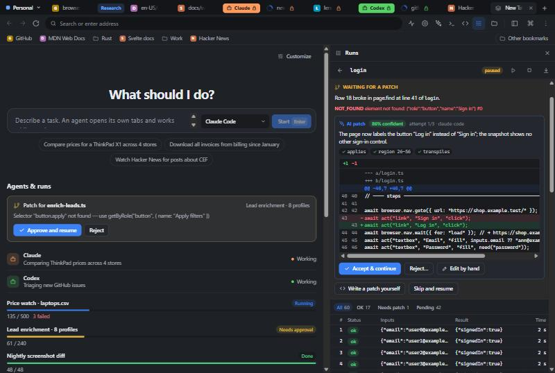 | 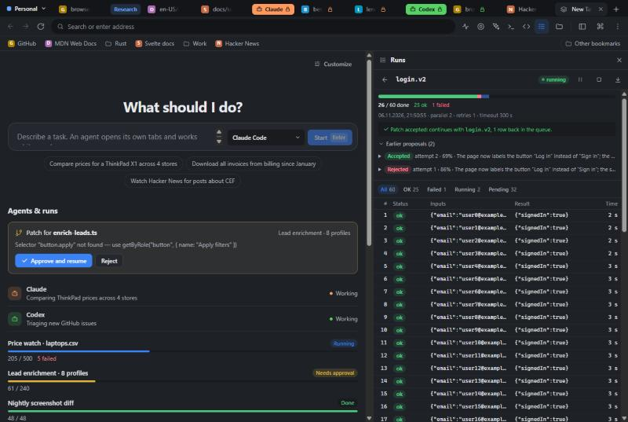 |
| mock: AI proposal in the Runs panel | mock: accepted, earlier proposals |
| 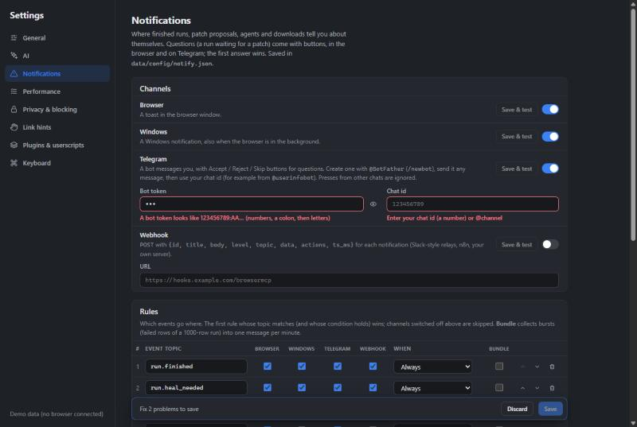 | 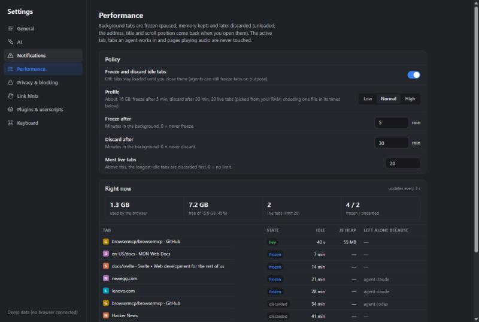 |
| mock: channel validation, unsaved changes bar | mock: governor policy and live tab table |
| 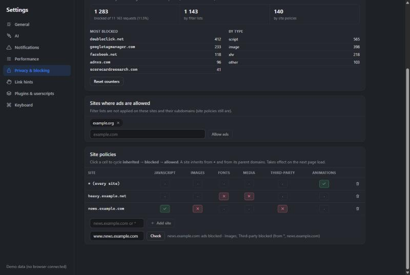 | 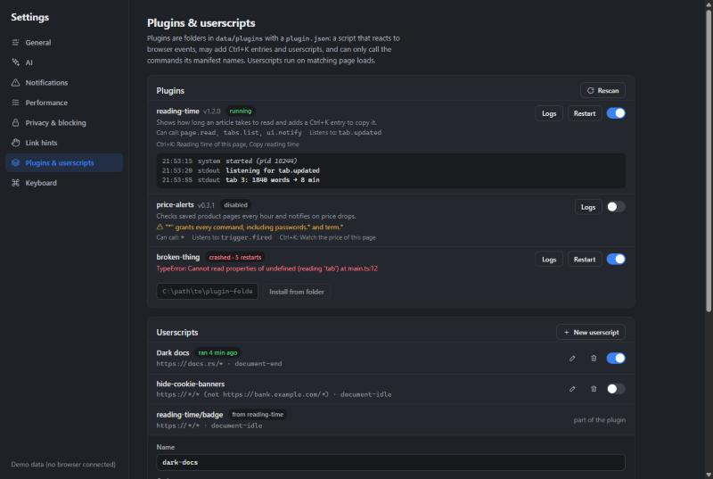 |
| mock: blocking stats, allowlist, site policies | mock: plugins, logs, userscripts |
| 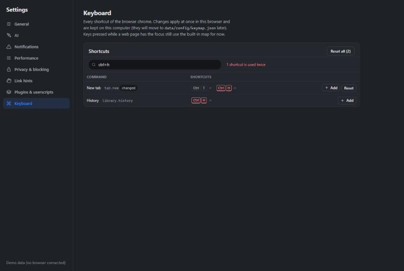 | 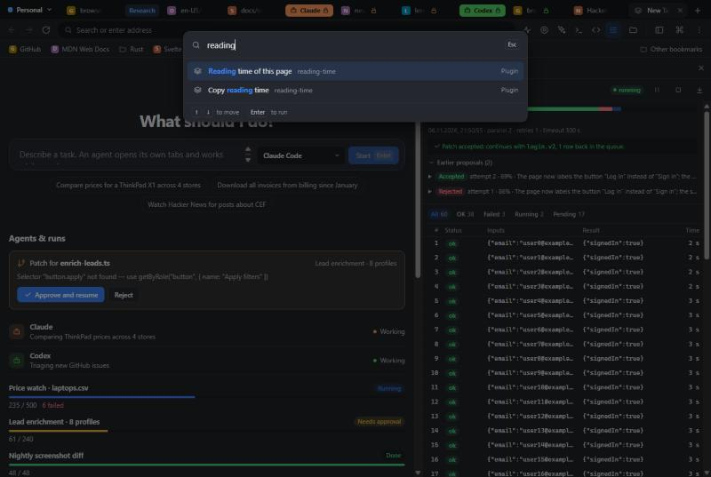 |
| mock: keymap search, a conflict | mock: plugin entries in Ctrl+K |
| 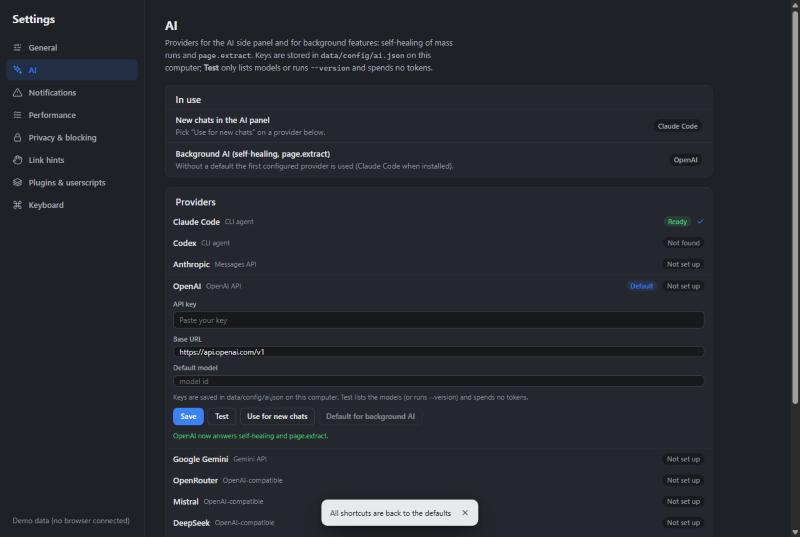 | 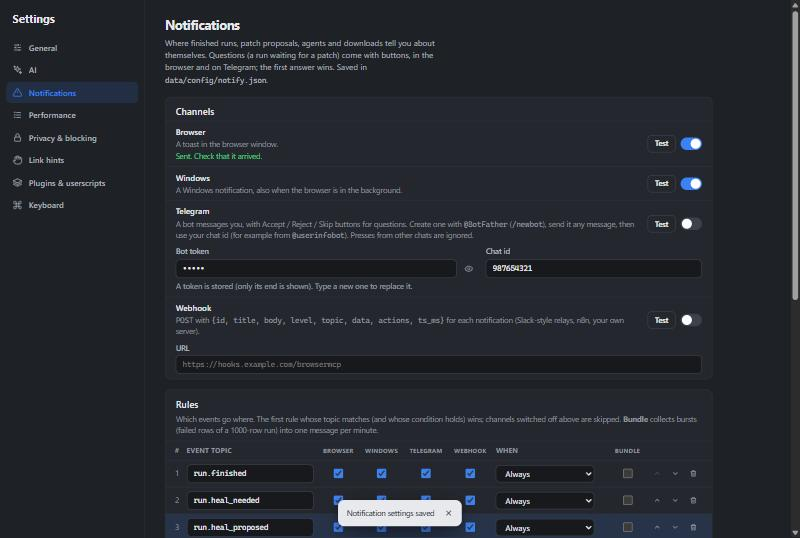 |
| mock: providers, default for background AI | real core: test sent, settings saved |
| 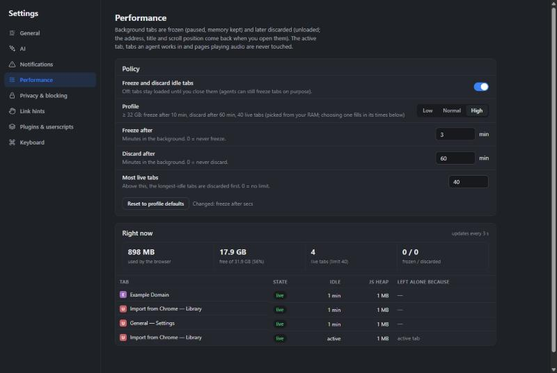 | 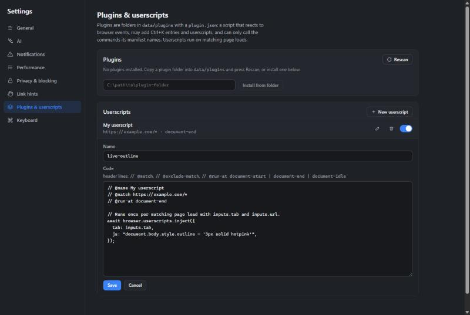 |
| real core: governor override, live tabs | real core: userscript from `userscripts.get` |

## Gaps

* On this main build, `bmcp://ui/` pages in content tabs (settings and library alike) stay on
  "Connecting to the browser…": the injected config is there and the server accepts a
  `bmcp://ui` handshake (curl: 101), but a `WebSocket` opened inside the tab never leaves
  `CONNECTING` (checked with `userscripts.inject`). Probably the local-network permission / the
  new tab lockdown in `crates/cef` (owned elsewhere); the dev UI against the same core works.

* Keyboard overrides live in localStorage until the core stores `data/config/keymap.json`.
  Keys pressed while a web page has focus go through the native mirror in
  `crates/cef/src/chrome/protocol.rs` (owned elsewhere), which knows neither the overrides nor
  Ctrl+, (needed: `VK_OEM_COMMA if ctrl => Ui("settings.open")`).
* Existing `notify.json` files keep their rules: the heal_proposed / applied / failed rules are
  only defaults for new files; the Notifications section offers *Add N missing default rules*.
* Telegram: Reject sends no feedback (there is no text input on a button); the UI asks for it.
* The userscript editor is a plain textarea (no Monaco / typings); plugins' own userscripts are
  read-only.
* Settings sections load once and on their own polling (performance, blocking counters, plugin
  logs); changes made elsewhere (e.g. an agent calling `notify.config_set`) show after switching
  sections.

## Startup & tabs, Search, Downloads, Site settings, Data & storage, About

Date: 2026-11-07. Six more sections, each backed by real browser behaviour (new crate
`crates/settings`, `bmcp-settings`; UI in `ui/src/settings/{Startup,Search,Downloads,
SiteSettings,Data,About}Section.svelte`, logic in `ui/src/lib/settings/e1-*.ts`, strings in
`ui/src/lib/i18n/{en,uk}/settings-{startup,search,downloads,sites,data,about}.ts`).

| Section | What it does | Commands | Stored in |
|---|---|---|---|
| Startup & tabs | on startup: last session / new tab page / specific pages (`--url`, `--no-restore`, `--headless` still win); Home button + home page; what a new tab shows (built-in page, blank, a URL); new tabs at the end or next to the current one; keep the window when its last tab closes; recently closed tabs (reopen one, clear) | `startup.config`, `tabs.closed`, `tabs.closed_reopen`, `tabs.closed_clear` | `data/config/startup.json` (closed tabs: `data/runtime/session.json`) |
| Search | default engine of the address bar (Google, Bing, DuckDuckGo, Brave, Startpage + own engines with `%s`), keywords (`@ddg cats` searches DuckDuckGo; built-in keywords start with `@` so ordinary queries like "d day" are not taken over), a "try it" box; the address bar hint says which engine | `search.config`, `search.url` | `data/config/search.json` |
| Downloads | download folder (default `data/downloads`; mass runs keep `data/runs/<run>/downloads`), Save as dialog for each file, open the folder, clear the list | `downloads.config`, `downloads.clear`, `system.open_path` | `data/config/downloads.json` |
| Site settings | remembered permissions per site (allow / block / forget, reset a site, add a rule, `*` = all sites), per-site zoom (reset one / all, open tabs follow at once), how pop-ups are handled | `permissions.list/set`, `zoom.list`, `zoom.reset` | `data/config/permissions.json`, `data/config/zoom.json` |
| Data & storage | clear history / downloads list / cookies / cache / site data for a time range and a workspace; data folder size by area (each profile separately); import from Chrome (opens the library wizard); backup hint | `browsing_data.clear`, `browsing_data.usage`, `import.*` | — |
| About | BrowserMCP / CEF / Chromium versions, OS, PID, uptime, API port and MCP / REST / WS addresses with the connection state, folders (data, logs, config, exe) with Open, license files next to the exe (open / show in folder), Copy diagnostics | `system.about` | — |

How the browser follows the settings:

* `crates/app` loads `BrowserSettings` before CEF starts, plans the start
  (`bmcp_settings::startup::plan`) and opens the extra startup pages once the API listens; the
  same instance goes into the registry, so a change through a command is in force at once.
* `crates/cef`: the download handler takes the folder and the Save as flag from the settings
  (never a dialog for mass-run tabs); `tabs.open` puts new tabs after the active one when asked;
  `close_tab` keeps the window (new tab page in place of the last tab) when asked; tabs the
  browser opens itself use the chosen new tab page; `zoom.rs` lists and resets per-host zoom.
* Clearing data: history and the downloads list in `browsermcp.sqlite`; cookies through the
  profile's cookie manager (with a time range: cookies of the sites visited in it); cache with
  CDP `Network.clearBrowserCache` and site data with `Storage.clearDataForOrigin` in a tab of
  that profile (an open one, else a temporary off-screen `about:blank` tab). Sites for site
  data: visited in the range, plus for "all time" every cookie domain and IndexedDB folder.
* `system.open_path` / `reveal_path` may also show the chosen download folder and the exe folder
  (`bmcp_system::ExtraRoots`), for "Open folder" and the license files. That is why the download
  folder can never be a system folder (`bmcp_settings::downloads::protected_reason`: a drive
  root, Windows, Program Files, ProgramData, Roaming AppData with the Startup folder,
  `%LOCALAPPDATA%\Microsoft`, the profile folder itself); a hand-edited `downloads.json` that
  points at one is ignored.
* Toolsets: `search.config` and `startup.config` are in the `ui` toolset (like
  `notify.config_set`), not in MCP's default `core,system`; an agent gets them with
  `/mcp?toolsets=ui`. `downloads.config` and `browsing_data.clear` are in `data`. Reading
  commands (`search.url`, `zoom.list`, `browsing_data.usage`, `system.about`) stay in `system`.
* `settings.changed {area}` on the bus (UI subscribes to `settings.*`): every window's address
  bar engine, new tab page and Home button follow at once (`ui/src/lib/settings/e1-prefs.svelte.ts`).

Gaps: there is no native folder picker (the download folder is typed); the Save as dialog and
the startup choices were not exercised in a live window (unit tests + the API e2e only); the
cache is always cleared completely (Chromium's CDP has no time range for it); with a time range,
cookies and site data are cleared for the sites visited in that range, not by creation time.
