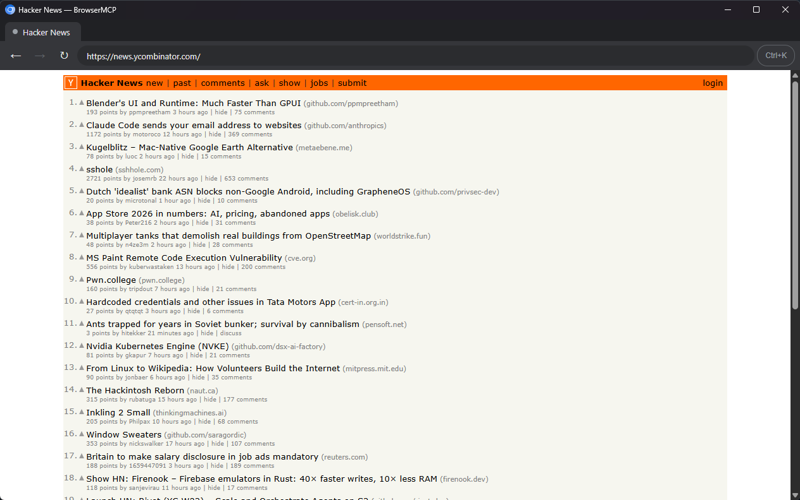
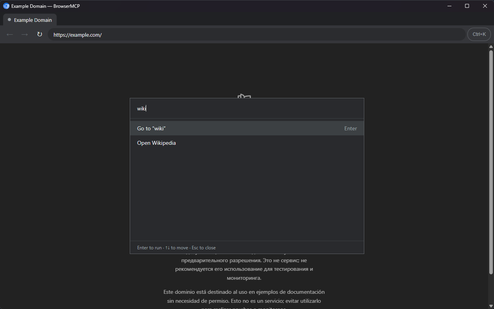
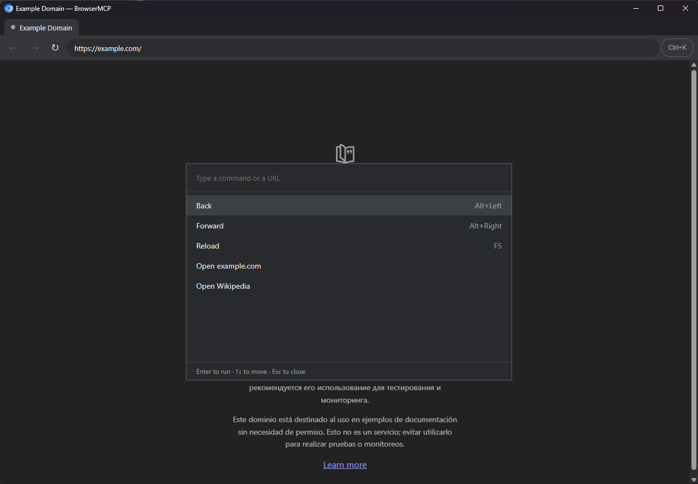
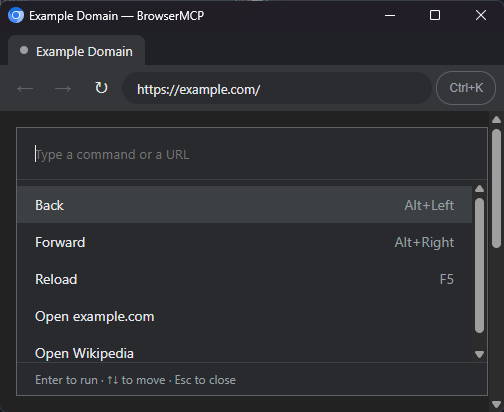
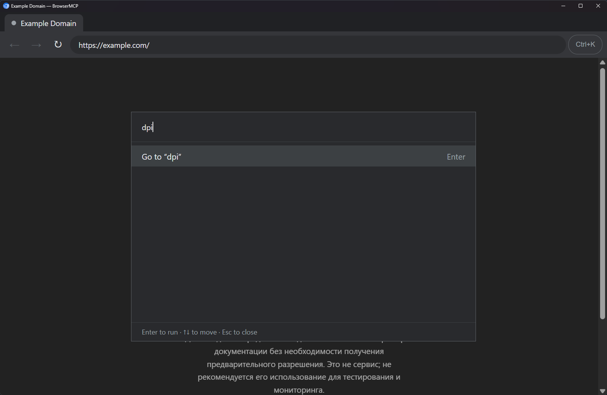

# Spikes S1, S2, S3

Date: 2026-11-06. CEF 156.0.15 (`cef` crate =156.3.0), Windows 11.

## S2 — UI-thread bridge + in-process CDP: GO

* `crates/cef/src/bridge.rs`: CEF objects live only in a thread-local `UiState` on the CEF UI
  thread. Async code calls `run_on_ui(|| ...)` → `post_task(UI)` + oneshot reply. Only `TabId`s
  cross threads. Never hold the `UiState` borrow while calling into CEF (re-entrancy).
* CDP goes through `BrowserHost::send_dev_tools_message` + a `DevToolsMessageObserver` per
  browser (`crates/cdp` does id matching, events, timeouts; 7 unit tests). No debugging port.
* Verified: `browsermcp --dump-ax https://example.com` prints the accessibility tree and exits 0.
* Pitfalls found:
  * Views windows must be closed with `Window::close()`; `close_browser()` alone leaves an empty
    window and `cef::shutdown()` never returns.
  * Drop all CEF references (`clear_ui_state`) before `cef::shutdown()`.
  * Windows exe needs an embedded compatibility manifest or the GPU process CHECK-crashes
    (`crates/app/build.rs`).
  * Logs go to stderr; stdout is for command output / future MCP stdio.
* Known gap: `navigate()` waits for "the next finished load"; if a previous load is still in
  flight it can return early. Fix in Phase 3 with CDP `Page.lifecycleEvent` + loaderId.

## S3 — MCP server (rmcp 3.9, Streamable HTTP): GO

* `crates/api`: `http://127.0.0.1:47800/mcp`, tools `system_ping`, `tabs_list`, `tabs_open`,
  `nav_goto`, `page_ax_tree` (preview formatter), `page_text`. Instance info in
  `data/runtime/endpoint.json`.
* Verified with raw MCP over curl: initialize → tools/list (6 tools) → tools/call on Wikipedia
  and Hacker News; unknown tab returns a readable tool error.
* Security: rmcp validates `Host` (loopback only) and we call `enforce_origin_validation()`, so
  any request with an `Origin` header (= any web page) gets 403. Both verified.
* Hand-written `#[tool]` methods are temporary; Phase 3 generates tools from the command registry.

## S1 — first decision: Alloy runtime style by default

In Chrome runtime style `quit_message_loop()` did not end `run_message_loop()` after the last
window closed (process hung). Alloy exits cleanly, and it is the style that gives full control for
our own Svelte chrome. `--chrome-style` keeps Chrome style available for experiments.

## S1 — window composition (UI view + content view + overlay): GO

Question: can one window be `[UI BrowserView] + [content BrowserView(s)] + [overlay]` with CEF
Views, Alloy style, with correct resize, focus, keyboard and DPI? **Yes.** It is now the default
layout; `--layout single` keeps the Phase 0 window (page only).



### How it is built (`crates/cef/src/chrome/`, `scheme.rs`, `shell.rs`)

```text
Window (vertical BoxLayout, cross axis STRETCH)
├─ UI BrowserView       bmcp://ui/index.html     preferred height 80 DIP
├─ content BrowserView  the web page             flex 1  ← the only "tab"
└─ overlay (Window::add_overlay_view, DOCKING_MODE_CUSTOM, can_activate=1)
   └─ palette BrowserView bmcp://ui/palette.html  600×400 DIP, centred over the content
```

* **Scheme.** `bmcp` is registered standard + secure + CORS + fetch enabled in *every* process:
  `ShellApp` (browser) and a tiny `SchemeApp` passed to `execute_process` (sub-processes —
  before this they got `None`). A `SchemeHandlerFactory` serves embedded pages
  (`crates/cef/assets/*.html`, `include_str!`).
* **Window identity.** Each composed window gets a key stored as the Window's view id
  (`Window::set_id`). Any handler finds its window from a `Browser` via
  `browser_view_get_for_browser(b).window().id()` — works for popups too (they inherit the
  parent's client).
* **Bridge state.** `UiState.tabs` holds content browsers only. UI/palette browsers live in
  `UiState.chrome_views`, the views of each window in `UiState.windows`. Each `ShellClient`
  carries a `ViewKind` (Content / Ui / Palette), so `list_tabs`, MCP and `--dump-ax` never see
  our own views, and `tabs_open`'s "tab created" event only fires for pages.
* **Shortcuts.** `KeyboardHandler::on_pre_key_event` on every browser (content, UI, palette):
  Ctrl+K (toggle palette), Ctrl+L (focus URL box), F5 / Ctrl+R, Alt+Left/Right, Esc (only
  consumed while the palette is open). Pure mapping in `protocol::shortcut` (unit-tested).
* **Popups** from a page open a new composed window around the popup BrowserView; popups from
  UI/palette are blocked. Navigations that try to leave `bmcp://ui/` in a chrome view (e.g. a
  link dropped on the strip) are cancelled and opened in the page instead. Alloy's default
  context menu is suppressed in chrome views (except in text fields).

### Spike command channel (Phase 3 replaces it with the WS API)

* UI page → browser: `fetch("bmcp://cmd/<name>?<args>")` — `ready`, `navigate?url=`, `back`,
  `forward`, `reload`, `stop`, `palette?action=show|hide|toggle`, `focus-content`. The scheme
  handler (IO thread) parses it (`protocol::parse_command`), answers `204` with
  `Access-Control-Allow-Origin: bmcp://ui`, and posts the command to the UI thread, where it runs
  **only if the sender browser id is one of our chrome views**. Verified: a web page doing
  `fetch("bmcp://cmd/navigate?...")` is logged and ignored.
* Browser → UI page: `frame.execute_java_script("window.bmcp.onState({url,title,loading,
  canGoBack,canGoForward})")` on address/title/loading changes of the content browser; the UI
  sends `ready` on load to get the current state. Palette gets `bmcp.onShow()`, Ctrl+L calls
  `bmcp.focusUrl()`.

### Verified (Windows 11, 96 DPI monitor, 2026-11-06)

| Check | Result |
|---|---|
| Window opens with UI strip + page | ✔ (screenshot above) |
| Typing a URL in the strip (`news.ycombinator.com`, `wikipedia.org`) navigates the page | ✔ url fix-up + search fallback |
| Title / URL / back-forward state update in the strip | ✔ |
| Ctrl+K from page, from the URL box and from the palette itself; palette button | ✔ toggles |
| Esc hides the palette and focus returns to the page (arrow keys scroll it) | ✔ |
| Palette item / "Go to …" + Enter navigates the page and closes the palette | ✔ |
| Ctrl+L, Alt+Left, Alt+Right, F5 work with focus in the page | ✔ |
| Resize 1300×900 → 520×420: strip fixed, page fills, palette re-centred and shrunk | ✔ |
| DPI 150 % (emulated with `--force-device-scale-factor=1.5`) | ✔ strip 120 px, palette 900×600 px |
| Popup (`window.open`) → new composed window, listed as a tab | ✔ |
| MCP `tabs_list` / `tabs_open` / `nav_goto` | ✔ only content browsers listed |
| `--dump-ax https://example.com` | ✔ exit 0 in 1.7 s, reports content tab |
| Closing the window (1 or 2 windows) exits with code 0 | ✔ |
| `--layout single` still works | ✔ |






### Pitfalls found

* **Preferred size with a 0 dimension is "empty".** `Size { width: 0, height: 80 }` from the view
  delegate is ignored and CEF falls back to the BrowserView default: the UI strip filled the
  window and the page got 0 px. Return a non-zero width (we use 1; the layout stretches it).
* **Closing a window with several browsers.** Calling `try_close_browser()` on the UI/palette
  browsers from `can_close` re-enters `can_close` synchronously; the votes interleave and the
  window never closes (process hang). Working rule: only the **content** browser votes (it may run
  beforeunload); when it says yes, destroy the overlay controller (like cefclient's overlay
  browser) and let the window close the UI views with it. Exit code 0 every time afterwards.
* **Overlay BrowserView must be Alloy** (cefclient says so too) — we force Alloy for the palette
  even with `--chrome-style`. Overlays must be added *after* the other children to be on top;
  with CUSTOM docking we re-position in `WindowDelegate::on_layout_changed`.
* **Z-order / transparency.** The overlay correctly sits above the native page (windowed
  rendering) and takes focus, but it is an opaque rectangle: windowed browsers cannot be
  transparent, so no dimmed backdrop or rounded/shadowed palette. Options for Phase 2: accept a
  plain box, or draw shadows inside the page, or use OSR for the overlay (cost: complexity).
* **Focus.** `View::request_focus()` on the BrowserView is enough to move keyboard focus between
  views. The UI page's `document.activeElement` keeps pointing at the URL input after focus moves
  to the page, so the UI must check `document.hasFocus()` before deciding "user is typing".
* **Keyboard.** `on_pre_key_event` sees every key in every view, so one handler covers all
  shortcuts. Match on `windows_key_code` of `RAWKEYDOWN`. (Testing note: `SendKeys` delivers
  letters as `VK_PACKET` (231) — use real `keybd_event` VK codes when testing shortcuts.)
* **CORS + cef-rs:** `StreamResourceHandler` with a header map lost its headers
  (`CefStringMultimap` is cloned shallowly and *cleared* on drop), so the CORS header vanished and
  `fetch` failed. We use a small own `ResourceHandler` that sets headers directly on the response.
* **Views windows default to close-button only** — `can_maximize/can_minimize/can_resize` must
  return 1 (now done for both layouts).
* **Popups** all open at the same default position; Phase 2 turns them into tabs anyway.
  Without `--disable-popup-blocking`, script popups without a user gesture are blocked (Chrome
  behaviour).
* **Build:** the worktree path was too long for MSVC (`C1083 Cannot open compiler generated
  file`) when building `libcef_dll_wrapper`; a short `CARGO_TARGET_DIR` fixes it.
* **Shutdown time:** in 2 of ~10 runs `cef::shutdown()` took ~15 s (still exit 0); the other runs
  took 0.1–0.2 s. Not reproduced on purpose; watch for it in Phase 2 (possibly sub-process
  teardown while other CEF instances were busy on the same machine).
* **Not verified:** real per-monitor DPI change (moving between monitors / changing the Windows
  scale needs a system setting change; Views uses DIP everywhere so it should follow), IME
  composition in the URL box and palette (CEF windowed mode uses the native IME path, expected to
  work), beforeunload cancel with the composed window (design keeps UI views alive because the
  page votes first), keyboard focus traversal with Tab between views.

### Recommendation for Phase 2

* Keep this structure: one composed window = UI view + content view(s) + palette overlay.
  Tabs = several content BrowserViews in the same slot (`set_visible` / swap child) — only the
  content kind is ever registered as a tab.
* Serve the Svelte build from `bmcp://ui/` (same scheme handler, files from disk in dev /
  embedded in release). Keep the `ViewKind` split and sender-id check for anything the UI can
  call.
* Replace the `bmcp://cmd/` + `execute_java_script` channel with the Phase 3 WS JSON-RPC API
  (Origin allowlist `bmcp://ui`). Until then the channel is small and documented in
  `crates/cef/src/chrome/protocol.rs`.
* Decide early whether the palette may stay an opaque box (cheap, works now) or needs OSR.
* Side panels (AI chat, traffic) can be more BrowserViews in a horizontal BoxLayout next to the
  content; the same `on_layout_changed` hook keeps overlays placed.

### How to run

```sh
cargo xtask run                       # composed window (default)
cargo xtask run -- --layout single    # Phase 0 window
cargo xtask run -- --force-device-scale-factor=1.5   # DPI check
RUST_LOG=info,bmcp_cef=debug cargo xtask run          # see commands / tab registration
```
